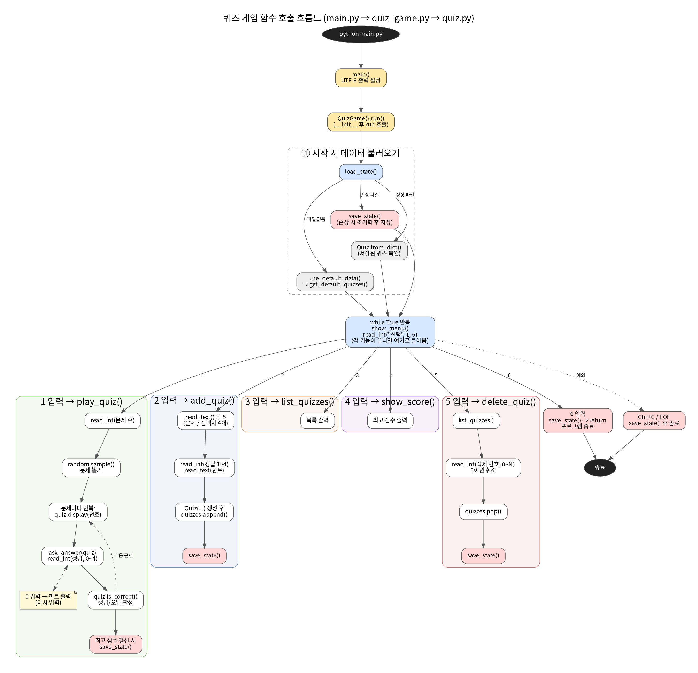

# 파이썬/Git 기초 퀴즈 게임

## 프로젝트 개요.
터미널에서 동작하는 콘솔 퀴즈 게임입니다. 메뉴에서 번호를 선택해 퀴즈 풀기, 퀴즈 추가, 퀴즈 목록, 점수 확인, 퀴즈 삭제를 할 수 있고, 프로그램을 종료해도 추가한 퀴즈와 최고 점수가 `state.json`에 저장되어 유지됩니다.

- Python 3.10 이상, 외부 라이브러리 없이 표준 라이브러리만 사용
- `Quiz`, `QuizGame` 두 클래스로 역할 분리
- Git/GitHub로 기능 단위 커밋, 브랜치 작업 후 병합

이 문서의 아래쪽 `과제 목표`와 `과제 수행에 필요한 추가 개념`에는 이 과제에서 배우는 개념을 정리하고, 실제로 쓰인 코드를 예시로 붙였습니다.

## 퀴즈 주제와 선정 이유
**주제: 파이썬/Git 기초**

이번 입학 연수의 학습 목표(변수와 자료형, 조건문/반복문, 함수, 클래스, JSON 파일 입출력, 예외 처리, Git 명령어)를 문제로 만들면 퀴즈를 만들고 푸는 과정이 곧 복습이 됩니다. 배운 내용을 스스로 설명할 수 있게 되는 것이 이 미션의 목표라서 이 주제를 골랐습니다.

## 실행 방법
```bash
git clone <저장소 URL>
cd <저장소 폴더>
python main.py        # macOS/Linux에서는 python3 main.py
```
Python 3.10 이상이 필요합니다. 확인: `python --version`

## 기능 목록
| 메뉴 | 기능 |
|---|---|
| 1. 퀴즈 풀기 | 풀 문제 수를 고르면 랜덤 순서로 출제, 정답/오답 안내, 결과 표시, 최고 점수 갱신. 문제에 힌트가 있으면 `0` 입력으로 확인 |
| 2. 퀴즈 추가 | 문제, 선택지 4개, 정답 번호(1-4), 힌트(선택)를 입력받아 저장 |
| 3. 퀴즈 목록 | 등록된 퀴즈 목록 출력 |
| 4. 점수 확인 | 최고 점수 확인 (아직 안 풀었으면 안내) |
| 5. 퀴즈 삭제 | 번호를 선택해 퀴즈 삭제 후 저장 |
| 6. 종료 | 저장 후 종료 |

입력/예외 처리: 앞뒤 공백 제거, 빈 입력, 숫자 아님, 범위 밖 숫자는 안내 후 재입력하고, `Ctrl+C`/입력 종료(EOF) 시 저장 후 안전 종료합니다. `state.json`이 없으면 기본 퀴즈로 시작하고, 손상되었으면 안내 후 기본 데이터로 복구합니다.

점수는 `정답 수 × 100 ÷ 푼 문제 수`(정수)로 계산합니다.

## 파일 구조
```
.
├── main.py              # 실행 진입점
├── quiz.py              # Quiz 클래스 (문제 한 개 표현)
├── quiz_game.py         # QuizGame 클래스 (메뉴, 게임 진행, 저장/불러오기)
├── default_quizzes.py   # 기본 퀴즈 12개 (Quiz 인스턴스)
├── state.json           # 실행 후 생성되는 저장 데이터
├── quiz_flow.png        # 함수 호출 흐름도
├── flow.dot             # 흐름도 원본 (Graphviz)
├── .gitignore
└── README.md
```

###  함수 호출 흐름
`main()`에서 시작해서 메뉴 입력(1~6)에 따라 어떤 함수가 호출되는지 나타낸 그림입니다.



## 데이터 파일 설명 (`state.json`)
- 경로: 프로젝트 루트의 `state.json` (UTF-8, 처음 저장할 때 자동 생성)
- 역할: 퀴즈 목록과 최고 점수를 저장해 프로그램을 다시 실행해도 유지

```json
{
  "quizzes": [
    {
      "question": "원격 저장소를 내 컴퓨터로 복제하는 Git 명령어는?",
      "choices": ["git init", "git commit", "git clone", "git push"],
      "answer": 3,
      "hint": ""
    }
  ],
  "best_score": 80,
  "best_correct": 4,
  "best_total": 5
}
```

| 필드 | 설명 |
|---|---|
| `quizzes` | 퀴즈 목록 |
| `quizzes[].question` | 문제 문장 |
| `quizzes[].choices` | 선택지 4개 (문자열 리스트) |
| `quizzes[].answer` | 정답 번호 (1~4) |
| `quizzes[].hint` | 힌트 (없으면 빈 문자열) |
| `best_score` | 최고 점수 (0~100, 아직 안 풀었으면 `null`) |
| `best_correct`, `best_total` | 최고 점수를 낸 게임의 정답 수와 문제 수 |

---

## 📌 과제 목표
이 과제를 마친 뒤에는 아래 개념을 **스스로 설명할 수 있어야** 합니다. 
퀴즈 게임을 완성하는 것만이 목적이 아니라, 만들면서 쓴 문법과 도구가 **무엇이고 왜 필요한지** 이해하는 것이 목표입니다.
각 개념은 "무엇인가 → 왜 쓰는가 → 이 과제 코드에서는 어떻게 쓰였나" 순서로 정리했습니다.

### 1. Python 기초

#### ✅ 변수
- **무엇인가**: 값에 이름표를 붙여 저장해 두는 공간입니다. `score = 80`은 "80이라는 값에 `score`라는 이름을 붙인다"는 뜻입니다. 같은 이름에 새 값을 다시 담을 수도 있습니다.
- **왜 쓰는가**: 값을 한 번 저장해 두면 여러 곳에서 이름으로 다시 쓸 수 있고, 나중에 값을 바꾸기도 쉽습니다. `x`보다 `score`처럼 의미 있는 이름을 쓰면 읽는 사람이 무엇인지 바로 알 수 있습니다.
- **이 과제에서는** (`play_quiz` 일부): 맞힌 개수를 변수에 담아 두고 문제를 풀 때마다 갱신하고, 점수를 계산해 최고 점수 변수에 기억합니다.
```python
correct = 0                          # 맞힌 개수를 담을 변수 (처음엔 0)
...
    correct += 1                     # 정답을 맞힐 때마다 1 증가
score = correct * 100 // count       # 계산 결과를 score라는 이름에 저장
self.best_score = score              # 최고 점수를 객체에 기억해 둠
```

#### ✅ 자료형: `int`, `str`, `bool`, `list`, `dict`
값의 종류를 **자료형**이라고 합니다. 종류에 따라 할 수 있는 일이 다릅니다. (숫자는 더할 수 있고, 문자열은 이어 붙일 수 있습니다.)

| 자료형 | 의미 | 예시 | 이 과제에서 쓰인 곳 |
|---|---|---|---|
| `int` | 정수 | `5`, `80` | 정답 번호, 점수, 문제 수 (`count = read_int(...)`) |
| `str` | 문자열(글자) | `"hello"` | 문제 문장, 선택지 (`question = read_text(...)`) |
| `bool` | 참/거짓 둘 중 하나 | `True`, `False` | `is_correct()`의 결과 (정답이면 `True`) |
| `list` | 순서가 있는 값의 모음. **번호(인덱스)** 로 접근하고 추가/삭제할 수 있음 | `["git init", "git clone"]` | 선택지 4개(`choices`), 퀴즈 전체 목록(`quizzes`) |
| `dict` | **이름(key)** 으로 값(value)을 찾는 모음 | `{"question": "...", "answer": 3}` | `Quiz.to_dict()`의 결과, `state.json` 전체 |

- `list`는 "몇 번째?"로 찾고, `dict`는 "무슨 이름?"으로 찾는다는 점이 다릅니다.
- 참고: `None`은 "값이 없음"을 뜻합니다. 아직 퀴즈를 풀지 않아 최고 점수가 없을 때 `self.best_score = None`으로 표현합니다.
```python
# 선택지 4개를 입력받아 list로 만들기 (add_quiz)
choices = [read_text(f"선택지 {i}: ") for i in range(1, 5)]

# Quiz 객체를 저장용 dict로 바꾸기 (Quiz.to_dict)
return {
    "question": self.question,     # str
    "choices": self.choices,       # list
    "answer": self.answer,         # int
    "hint": self.hint,             # str
}
```

#### ✅ 조건문: `if` / `elif` / `else`
- **무엇인가**: 조건이 참인지 거짓인지에 따라 실행할 코드를 고르는 문법입니다. 위에서부터 차례로 검사해서 **처음 참인 하나만** 실행합니다. `elif`는 "그게 아니고 이 조건이면", `else`는 "위 조건이 모두 아니면"입니다.
- **왜 쓰는가**: 프로그램이 상황에 따라 다르게 행동해야 하기 때문입니다. (정답이면 칭찬하고, 오답이면 정답을 알려 주기)
```python
if score >= 80:
    print("우수")
elif score >= 50:
    print("보통")
else:
    print("분발")
```
- **이 과제에서는**: 정답/오답에 따라 다른 메시지를 출력하고(`ask_answer`), 새 최고 점수일 때만 갱신합니다(`play_quiz`). 이 과제 코드에서는 `if`와 `else` 흐름을 주로 썼고 `elif`는 쓰이지 않았습니다.
```python
# ask_answer: 정답이면 True, 아니면 안내 후 False
if quiz.is_correct(user_answer):
    print("정답입니다!")
    return True
print(f"오답입니다. 정답은 {quiz.answer}번 '{quiz.choices[quiz.answer - 1]}' 입니다.")
return False

# play_quiz: 처음 풀었거나, 이전 최고 점수보다 높을 때만 갱신
if self.best_score is None or score > self.best_score:
    self.best_score = score
```

#### ✅ 반복문: `for` vs `while`
- **무엇인가**: 같은 코드를 여러 번 실행하는 문법입니다.
  - `for`: **횟수나 대상이 정해져 있을 때**. "목록의 항목마다 하나씩" 반복합니다.
  - `while`: **끝나는 시점을 모를 때**. 조건이 참인 동안 계속 반복합니다.
- **고르는 기준**: 반복 횟수를 미리 알면 `for`, "올바른 값이 올 때까지"처럼 언제 끝날지 모르면 `while`입니다. `break`는 반복을 빠져나가고, `continue`는 이번 차례를 건너뛰고 처음으로 돌아갑니다.
- **이 과제에서는**: 고른 문제 수만큼 한 문제씩 출제할 때 `for`를, 숫자를 제대로 입력할 때까지 다시 묻는 부분과 종료를 고르기 전까지 메뉴를 계속 보여 주는 부분에 `while True`를 썼습니다.
```python
# play_quiz: 뽑힌 문제 개수만큼 정확히 반복 → for
for number, quiz in enumerate(questions, start=1):
    quiz.display(number)
    ...

# run: 종료(6번)를 고르기 전까지 계속 메뉴를 보여 줌 → while
while True:
    self.show_menu()
    choice = read_int("선택: ", 1, 6)
    if choice == 6:
        self.save_state()      # 종료 전에 저장
        return
    actions[choice]()
```

#### ✅ 함수, 매개변수, 반환값
- **무엇인가**: 자주 쓰는 동작에 이름을 붙여 묶어 둔 코드 덩어리입니다. `def`로 정의하고, 이름을 불러서(호출해서) 실행합니다.
  - **매개변수**: 함수가 일하기 위해 **받는 재료**(입력)
  - **반환값**: 함수가 일을 마치고 `return`으로 **돌려주는 결과**(출력). `return`이 없으면 아무것도 돌려주지 않습니다(`None`).
- **왜 쓰는가**: 같은 코드를 여러 번 복사하지 않고 재사용할 수 있고, 기능별로 나누어 두면 읽기 쉽고 고치기 쉽습니다. 모든 코드를 한 함수에 쓰지 않고 기능별로 나누는 것이 이 과제의 구조 요구사항이기도 합니다.
```python
def add(a, b):        # a, b: 매개변수 (받는 재료)
    return a + b      # 계산 결과를 돌려줌 (반환값)

result = add(2, 3)    # 2, 3을 넣어 호출 → result에 5가 담김
```
- **이 과제에서는**: `read_int(prompt, low, high)`가 안내 문구와 허용 범위를 매개변수로 받고, 검증이 끝난 정수를 반환합니다. 메뉴 선택, 정답 입력, 문제 수 입력에서 같은 함수를 재사용합니다.
```python
def read_int(prompt, low, high):
    """low~high 사이 정수를 받을 때까지 다시 묻는다."""
    while True:
        text = input(prompt).strip()
        if text == "":
            print("⚠️ 빈 입력입니다. 숫자를 입력하세요.")
            continue
        try:
            number = int(text)
        except ValueError:
            print(f"⚠️ 숫자만 입력할 수 있습니다. {low}-{high} 사이의 숫자를 입력하세요.")
            continue
        if not low <= number <= high:
            print(f"⚠️ 잘못된 입력입니다. {low}-{high} 사이의 숫자를 입력하세요.")
            continue
        return number                     # 검증을 통과한 값만 반환

choice = read_int("선택: ", 1, 6)          # 메뉴: 1~6
user_answer = read_int("정답 입력: ", 1, 4)  # 정답: 1~4
```
이 함수 하나에 `while`(될 때까지 반복), `if`(빈 입력/범위 검사), `try/except`(숫자 변환 실패 처리), `return`(결과 돌려주기)이 모두 들어 있습니다.

### 2. 클래스와 객체

#### ✅ 클래스와 객체
- **무엇인가**: **클래스는 설계도, 객체는 그 설계도로 만든 실제 물건**입니다. (붕어빵 틀과 붕어빵의 관계) 클래스는 "이런 데이터를 갖고 이런 동작을 한다"를 정의하고, 객체(인스턴스)는 그 틀로 찍어낸 하나하나입니다.
- **왜 쓰는가**: 서로 관련된 데이터와 동작을 하나로 묶어 코드를 역할별로 정리할 수 있습니다. 같은 틀로 객체를 여러 개 만들 수 있어서, 퀴즈가 8개든 100개든 같은 방식으로 다룰 수 있습니다.
- **이 과제에서는**: 퀴즈 한 문제는 `Quiz` 클래스, 게임 전체(메뉴, 풀기, 추가, 저장)는 `QuizGame` 클래스가 맡습니다. "문제 하나"를 다루는 일과 "게임 전체"를 다루는 일을 나눈 것입니다.
```python
# default_quizzes.py: Quiz 설계도로 퀴즈 객체를 여러 개 만든다
Quiz("'hello' 처럼 따옴표로 감싼 값의 자료형은?",
     ["int", "str", "bool", "dict"], 2,
     "string(문자열)의 줄임말이에요.")

# main.py: QuizGame 설계도로 게임 객체를 하나 만들어 실행한다
QuizGame().run()
```

#### ✅ 속성(attribute)과 메서드(method)
- **속성**: 객체가 **가지고 있는 데이터**(클래스 안의 변수)입니다. 명사에 가깝습니다. (문제, 선택지, 정답)
- **메서드**: 객체가 **할 수 있는 동작**(클래스 안의 함수)입니다. 동사에 가깝습니다. (출력하기, 정답 확인하기) `객체.메서드()` 형태로 호출합니다.

| 클래스 | 속성 | 메서드 |
|---|---|---|
| `Quiz` | `question`, `choices`, `answer`, `hint` | `display()`(문제 출력), `is_correct()`(정답 확인), `to_dict()`, `from_dict()` |
| `QuizGame` | `quizzes`, `best_score`, `best_correct`, `best_total`, `state_file` | `show_menu()`, `play_quiz()`, `add_quiz()`, `list_quizzes()`, `show_score()`, `delete_quiz()`, `load_state()`, `save_state()`, `run()` |

```python
q = quiz                      # Quiz 객체 하나
print(q.question)             # 속성 읽기
print(q.is_correct(3))        # 메서드 호출 → 정답이면 True
```

#### ✅ `__init__`과 `self`
- **`__init__`**: 객체가 **만들어질 때 자동으로 한 번 실행**되어 속성의 처음 값을 정해 주는 메서드입니다. `Quiz(...)`라고 쓰는 순간 실행됩니다.
- **`self`**: **"지금 다루고 있는 바로 그 객체 자신"** 을 가리킵니다. 같은 클래스로 만든 객체가 여러 개일 때 `self` 덕분에 각 객체가 자기 값을 따로 가질 수 있습니다. (퀴즈 1의 `self.question`과 퀴즈 2의 `self.question`은 서로 다른 값)
- **이 과제에서는** (`quiz.py`):
```python
class Quiz:
    def __init__(self, question, choices, answer, hint=""):
        self.question = question    # 속성: 객체가 가진 데이터
        self.choices = choices
        self.answer = answer        # 1~4 중 하나의 번호
        self.hint = hint            # 없으면 빈 문자열 (기본값)

    def is_correct(self, user_answer):     # 메서드: 객체가 하는 동작
        return user_answer == self.answer  # self.answer = 이 객체의 정답
```
`hint=""`처럼 **기본값**을 주면, 힌트 없이 `Quiz(문제, 선택지, 정답)`만 써도 됩니다.

### 3. 파일 입출력

#### ✅ 파일을 열고, 읽고, 쓰는 기본 과정
- **왜 필요한가**: 변수에 담긴 값은 프로그램이 끝나면 사라집니다. 파일에 저장해 두면 프로그램을 껐다 켜도 데이터가 남습니다. 이 과제에서 추가한 퀴즈와 최고 점수가 유지되는 이유입니다.
- **기본 과정**: **열기 → 읽기 또는 쓰기 → 닫기**. 파이썬에서는 `with open(...)`을 쓰면 블록이 끝날 때 파일이 자동으로 닫혀서 닫는 것을 잊을 걱정이 없습니다.
  - 모드: `"r"`는 읽기, `"w"`는 쓰기(기존 내용을 덮어씀)
  - `encoding="utf-8"`: 한글이 깨지지 않도록 문자 인코딩을 지정
- **이 과제에서는**: `load_state()`가 시작할 때 `state.json`을 읽고, `save_state()`가 퀴즈 추가/삭제, 최고 점수 갱신, 종료 시점에 저장합니다.
```python
# 읽기 (load_state)
with open(self.state_file, "r", encoding="utf-8") as f:
    data = json.load(f)

# 쓰기 (save_state)
with open(tmp_file, "w", encoding="utf-8") as f:
    json.dump(data, f, ensure_ascii=False, indent=2)
```

#### ✅ JSON
- **무엇인가**: 데이터를 **텍스트로 표현하는 약속된 형식**입니다. 파이썬의 `dict`, `list`와 모양이 거의 같아서 `{"이름": 값}`, `[값, 값]` 형태로 씁니다.
- **왜 데이터 저장에 쓰는가**
  - 사람이 열어서 읽고 확인할 수 있습니다.
  - 거의 모든 프로그래밍 언어가 지원해서 다른 프로그램과 데이터를 주고받기 쉽습니다.
  - 파이썬의 `json` 모듈로 `dict`/`list`와 JSON 사이를 한 줄로 변환합니다. (`json.dump`로 저장, `json.load`로 불러오기)
  - 퀴즈 목록과 점수처럼 구조가 있는 데이터를 별도 데이터베이스 없이 그대로 저장할 수 있습니다.
- **이 과제에서는**: 퀴즈 목록(`quizzes`)과 최고 점수(`best_score`)를 JSON으로 `state.json`에 저장합니다. 구조는 위의 "데이터 파일 설명"에 있습니다. `ensure_ascii=False`는 한글을 `\uXXXX` 같은 코드로 바꾸지 않고 그대로 저장하게 하고, `indent=2`는 사람이 읽기 좋게 들여쓰기합니다.

#### ✅ `try` / `except` : 에러가 나도 프로그램이 멈추지 않게! 
- **무엇인가**: 오류가 날 수 있는 코드를 `try`에 넣어 두고, 오류가 나면 프로그램이 멈추는 대신 `except`에서 대응하게 하는 문법입니다.
                `except 뒤에 오류 종류`를 적어서 어떤 오류를 처리할지 정합니다.
- **왜 쓰는가**: 사용자가 숫자 대신 글자를 입력하거나, 파일이 없거나 손상되는 일은 언제든 생길 수 있습니다. 이런 예상 가능한 오류에도 프로그램이 갑자기 꺼지지 않고, 안내한 뒤 계속 동작하게 하기 위해서입니다.
```python
try:
    number = int(text)               # "abc"처럼 숫자가 아니면 ValueError 발생
except ValueError:
    print("숫자만 입력하세요.")       # 멈추지 않고 안내
```
- **이 과제에서는** 네 곳에서 처리합니다.
  1. 숫자가 아닌 입력 → `ValueError` (`read_int`)
  2. 손상된 `state.json` → 안내 후 기본 데이터로 복구 (`load_state`)
  3. 저장 실패 → `OSError` (`save_state`)
  4. `Ctrl+C`, 입력 스트림 종료 → 저장 후 안전 종료 (`run`)
```python
# load_state: 파일이 손상되어도 프로그램이 멈추지 않고 기본 데이터로 시작
try:
    with open(self.state_file, "r", encoding="utf-8") as f:
        data = json.load(f)
    quizzes = [Quiz.from_dict(item) for item in data["quizzes"]]
    ...
except (OSError, ValueError, KeyError, TypeError, AttributeError) as e:
    print(f"⚠️ 데이터 파일을 읽을 수 없습니다. ({type(e).__name__}) 기본 데이터로 초기화합니다.")
    self.use_default_data()
    self.save_state()
    return

# run: Ctrl+C(KeyboardInterrupt), 입력 종료(EOFError)도 안전하게 종료
except (KeyboardInterrupt, EOFError):
    print("\n\n⚠️ 입력이 중단되었습니다. 데이터를 저장하고 종료합니다.")
    self.save_state()
```

### 4. Git 기초

#### Git이란, 그리고 왜 필요한가
- **무엇인가**: 파일의 **변경 이력을 기록하고 관리하는 버전 관리 도구**입니다. 작업 중간중간 "저장 시점"을 사진처럼 찍어 두는 것과 같습니다.
- **왜 필요한가**
  - 실수하거나 코드가 망가졌을 때 **이전 상태로 되돌릴 수 있습니다.**
  - 무엇을, 언제, 왜 바꿨는지 **기록이 남습니다.** (커밋 메시지)
  - 여러 사람이 **같은 프로젝트를 동시에 작업하고 합칠 수 있습니다.**
  - GitHub 같은 원격 저장소에 올려 두면 **백업과 공유**가 됩니다.
- **이 과제에서는**: 메뉴, `Quiz` 클래스, 퀴즈 풀기, 퀴즈 추가처럼 기능 하나를 끝낼 때마다 커밋해서 개발 과정을 기록했습니다. 실제 커밋 메시지 예시는 다음과 같습니다.
  - `메뉴 기능 구현 (입력 검증, 종료 처리)`
  - `퀴즈 풀기 기능 구현 (출제, 채점, 결과 표시)`
  - `Refactor: QuizGame 클래스로 게임 로직 분리`
  - `state.json 저장/불러오기 구현 (파일 없음/손상 처리)`   

## Git 기본 명령어

| 명령어 | 하는 일 | 사용 예 |
|---|---|---|
| `git init` | 현재 폴더를 Git 저장소로 만든다. 이때부터 변경 이력을 추적할 수 있다. | `git init` |
| `git add` | 변경한 파일을 다음 커밋에 포함할 대상(스테이징 영역)으로 올린다. | `git add main.py` |
| `git commit` | 스테이징한 변경 내용을 설명 메시지와 함께 하나의 기록(커밋)으로 저장한다. 내 컴퓨터에만 저장된다. | `git commit -m "Feat: 메뉴 기능 구현"` |
| `git push` | 내 컴퓨터의 커밋을 GitHub 같은 원격 저장소로 올린다. | `git push origin main` |
| `git pull` | 원격 저장소의 새 커밋을 가져와서 내 작업 폴더에 합친다. | `git pull` |
| `git checkout` | 다른 브랜치로 이동한다. `-b` 옵션을 쓰면 새 브랜치를 만들면서 이동한다. | `git checkout -b feature/play-quiz` |
| `git clone` | 원격 저장소 전체(코드와 커밋 이력)를 내 컴퓨터에 복제한다. | `git clone <저장소 URL>` |
| `git branch` | 브랜치 목록을 보여주거나, 브랜치를 만들고 삭제한다. 현재 브랜치에는 `*` 표시가 붙는다. | `git branch`, `git branch -d feature/play-quiz` |
| `git merge` | 다른 브랜치의 작업 내용을 현재 브랜치로 합친다. `--no-ff` 옵션을 쓰면 병합 기록(merge commit)을 반드시 남긴다. | `git merge --no-ff feature/play-quiz` |
| `git log` | 커밋 이력을 보여준다. `--oneline --graph` 옵션을 쓰면 한 줄씩, 브랜치 갈래를 그림으로 볼 수 있다. | `git log --oneline --graph` |
  

#### 기본 명령어 7가지
작업 흐름은 **작업 폴더에서 수정 → `add`로 커밋할 것 선택 → `commit`으로 로컬에 기록 → `push`로 원격(GitHub)에 올리기**입니다.

| 명령어 | 하는 일 | 사용 예 |
|---|---|---|
| `git init` | 현재 폴더를 Git 저장소로 만든다 (처음 한 번) | `git init` |
| `git add` | 다음 커밋에 포함할 변경 파일을 고른다 | `git add quiz.py` / `git add .` |
| `git commit` | 고른 변경을 이력으로 기록한다 (로컬) | `git commit -m "Feat: 퀴즈 출제 기능 구현"` |
| `git push` | 내 로컬 커밋을 원격 저장소에 올린다 | `git push origin main` |
| `git pull` | 원격 저장소의 새 변경을 가져와 내 작업에 합친다 | `git pull` |
| `git checkout` | 다른 브랜치로 이동한다 (`-b`를 붙이면 새로 만들고 이동) | `git checkout -b feature/play` |
| `git clone` | 원격 저장소를 내 컴퓨터에 통째로 복제한다 (처음 한 번) | `git clone <저장소 URL>` |

#### 브랜치 생성과 병합
- **브랜치**: 메인 작업(`main`)에서 갈라져 나온 **독립된 작업 갈래**입니다. `main`을 건드리지 않고 새 기능을 안전하게 만들어 볼 수 있습니다.
- **병합(merge)**: 브랜치에서 완성한 기능을 `main`에 합치는 것입니다. 기능 개발은 브랜치에서 하고, 완성되면 `main`으로 합치는 방식이 협업의 기본입니다.
- **이 과제에서는**: "퀴즈 풀기" 기능을 별도 브랜치에서 만든 뒤 `main`에 병합했습니다. (커밋 이력의 `Merge: 퀴즈 풀기 브랜치 병합`)
  
| commit 이력 (git log --oneline) 스크린샷 | 브랜치 생성과 병합(git log --oneline --graph) 스크린샷 |
|---|---|
|||


#### `clone`과 `pull`
- **`clone`**: 원격 저장소를 **처음 통째로 복제**할 때 한 번 씁니다.
- **`pull`**: 이미 가진 저장소에서 **원격의 새 변경을 가져올 때** 반복해서 씁니다.
- **이 과제에서는**: 저장소를 다른 폴더에 `clone`한 뒤 거기서 수정하고 `push`하고, 원래 작업 폴더에서 `pull`로 변경이 반영되는지 확인하는 실습을 합니다. 다른 곳에서 바뀐 내용이 내 폴더로 들어오는 흐름을 직접 경험하는 것이 목적입니다.


| clone 생성 스크린샷 | push, pull 스크린샷 |
|---|---|
|||


---

## 과제 수행에 필요한 추가 개념
과제 목표에는 직접 나오지 않지만, 이 퀴즈 게임을 만들고 이해하려면 알아야 하는 개념입니다.

### 🔍 모듈과 `import`, 표준 라이브러리
- **무엇인가**: 코드를 파일 단위로 나눈 것이 **모듈**이고, 다른 파일의 기능을 가져다 쓰는 것이 `import`입니다. 파이썬이 기본으로 제공하는 모듈 묶음이 **표준 라이브러리**입니다. 이 과제는 외부 라이브러리 설치 없이 표준 라이브러리만 사용합니다.
- **왜 쓰는가**: 파일 하나에 모든 코드를 넣으면 길고 복잡해지므로, 역할별로 파일을 나누고 필요한 곳에서 가져다 씁니다.
- **이 과제에서는** (`quiz_game.py` 위쪽):
```python
import json                  # 표준 라이브러리: JSON 저장/불러오기
import random                # 표준 라이브러리: 랜덤 출제
from pathlib import Path     # 표준 라이브러리: 파일 경로 다루기

from default_quizzes import get_default_quizzes   # 내가 만든 모듈
from quiz import Quiz                              # 내가 만든 모듈
```

### 🔍 파일 구조와 역할 분리
- **무엇인가**: 하는 일에 따라 파일과 클래스를 나누는 설계입니다. 각 부분이 **한 가지 역할**만 맡게 합니다.
- **왜 쓰는가**: 문제가 생겼을 때 어디를 볼지 알기 쉽고, 한 부분을 고쳐도 다른 부분에 영향이 적습니다.
- **이 과제에서는**: `main.py`(실행 시작), `quiz.py`(퀴즈 한 문제), `quiz_game.py`(게임 진행과 저장), `default_quizzes.py`(기본 데이터)로 나누었습니다. 호출 순서는 위의 "함수 호출 흐름" 그림에서 볼 수 있습니다.

### 🔍 `if __name__ == "__main__"` 와 `main()`
- **무엇인가**: 파일을 **직접 실행했을 때만** 아래 코드를 실행하게 하는 관례입니다. 다른 파일에서 `import`할 때는 실행되지 않습니다.
- **왜 쓰는가**: 프로그램의 시작점을 한 곳(`main()`)으로 모아서 읽기 쉽게 하고, 파일을 `import`해도 프로그램이 저절로 시작되지 않게 합니다.
- **이 과제에서는** (`main.py`): 시작점인 `main()`에서 한글 출력 설정을 한 뒤 `QuizGame().run()`으로 게임을 시작합니다.
```python
def main():
    for stream in (sys.stdout, sys.stderr):
        try:
            stream.reconfigure(encoding="utf-8")   # 윈도우 콘솔에서도 한글/이모지 깨짐 방지
        except (AttributeError, ValueError):
            pass
    QuizGame().run()

if __name__ == "__main__":
    main()
```

### 🔍 입력 검증
- **무엇인가**: 사용자가 넣은 값을 **그대로 믿지 않고 먼저 검사**하는 것입니다. 사용자는 빈 입력, 글자, 범위 밖 숫자 등 예상 못 한 값을 얼마든지 넣을 수 있습니다.
- **왜 쓰는가**: 검사 없이 쓰면 프로그램이 오류로 멈추거나 잘못된 데이터가 저장됩니다.
- **이 과제에서는**: 숫자 입력은 `read_int`가 ① 앞뒤 공백 제거(`strip()`) ② 빈 입력 ③ 숫자 변환 실패 ④ 범위 밖 숫자를 차례로 검사하고, 어느 하나라도 걸리면 안내 후 다시 묻습니다. 글자 입력은 `read_text`가 빈 입력을 걸러 냅니다. (위의 `read_int` 코드 참고)

#  🔍 객체와 `dict`/JSON 사이의 변환 (직렬화)
- **무엇인가**: JSON 파일에는 `Quiz` 객체를 그대로 저장할 수 없으므로, 저장할 때는 **객체 → `dict` → JSON**으로, 불러올 때는 **JSON → `dict` → 객체**로 바꿉니다.
- **왜 쓰는가**: 프로그램 안의 객체와 파일 속 텍스트는 형태가 다르기 때문에, 서로 오갈 수 있는 변환 통로가 필요합니다.
- **이 과제에서는**: `Quiz.to_dict()`가 객체를 `dict`로, `Quiz.from_dict()`가 `dict`를 객체로 바꿉니다. 불러올 때는 파일이 손상되었을 수 있으므로, `from_dict()`가 형식을 검사해서 이상하면 `ValueError`를 일으키고 `load_state()`의 `except`가 받아 처리합니다.
```python
@staticmethod
def from_dict(data):
    """딕셔너리에서 Quiz 객체를 만든다. 형식이 잘못되면 ValueError."""
    ...
    if not isinstance(choices, list) or len(choices) != 4:
        raise ValueError("choices는 4개여야 합니다")
    ...
    return Quiz(question, choices, answer, hint)
```
`@staticmethod`는 객체(`self`) 없이 클래스 이름으로 바로 부르는 메서드를 만들 때 씁니다. (`Quiz.from_dict(item)`)

### 🔍 안전한 저장: 임시 파일에 쓰고 교체하기
- **무엇인가**: 원래 파일을 바로 덮어쓰지 않고 **임시 파일에 먼저 쓴 뒤, 성공하면 원래 파일과 교체**하는 방식입니다.
- **왜 쓰는가**: 저장하는 도중 프로그램이 멈추거나 오류가 나도 원래 파일이 반쯤 쓰인 채 망가지지 않습니다.
- **이 과제에서는** (`save_state`): `state.json.tmp`에 먼저 쓰고 `replace`로 교체합니다. 임시 파일(`*.tmp`)은 `.gitignore`에 넣어 Git에 올라가지 않게 했습니다.
```python
tmp_file = self.state_file.with_name(self.state_file.name + ".tmp")
with open(tmp_file, "w", encoding="utf-8") as f:
    json.dump(data, f, ensure_ascii=False, indent=2)
tmp_file.replace(self.state_file)       # 쓰기에 성공한 뒤에만 원래 파일과 교체
```

### 🔍 함수를 값처럼 쓰기: 메뉴 분기
- **무엇인가**: 파이썬에서는 함수도 변수에 담거나 `dict`의 값으로 넣을 수 있습니다. 이름 뒤에 `()`를 붙이면 그때 실행됩니다.
- **왜 쓰는가**: `if`를 번호마다 길게 나열하는 대신, "번호 → 실행할 함수" 표를 만들어 짧고 읽기 쉽게 분기할 수 있습니다.
- **이 과제에서는** (`run`):
```python
actions = {
    1: self.play_quiz,
    2: self.add_quiz,
    3: self.list_quizzes,
    4: self.show_score,
    5: self.delete_quiz,
}
...
actions[choice]()     # choice가 2이면 self.add_quiz()가 실행됨
```

### 🔍 자주 쓰인 편의 문법
| 문법 | 의미 | 이 과제에서 쓰인 곳 |
|---|---|---|
| f-string | 문자열 안에 `{}`로 변수 값을 넣기 | `print(f"📝 퀴즈를 시작합니다! (총 {count}문제)")` |
| `enumerate` | 반복하면서 번호도 함께 얻기 | `for number, quiz in enumerate(questions, start=1)` |
| `//` (정수 나눗셈) | 나눈 몫만 구하기 | `score = correct * 100 // count` (소수점 없는 점수) |
| 리스트 컴프리헨션 | 반복해서 `list`를 한 줄로 만들기 | `choices = [read_text(f"선택지 {i}: ") for i in range(1, 5)]` |
| `random.sample` | 중복 없이 무작위로 뽑기 | `questions = random.sample(self.quizzes, count)` |
| 상수(대문자 이름) | 바뀌지 않는 값에 붙이는 관례적 이름 | `LINE = "=" * 40`, `STATE_FILE` |

### `.gitignore`와 커밋 메시지
- **`.gitignore`**: Git이 **추적하지 않을 파일**을 적어 두는 파일입니다. 파이썬이 자동으로 만드는 캐시(`__pycache__/`, `*.pyc`), 임시 파일(`*.tmp`), 편집기 설정(`.vscode/`, `.idea/`)처럼 코드가 아닌 파일이 저장소에 섞이지 않게 합니다.
- **커밋 메시지**: "무엇을 바꿨는지"가 드러나게 씁니다. `Feat: 기능 추가`, `Fix: 오류 수정`, `Docs: 문서 수정`, `Refactor: 구조 개선`처럼 앞에 종류를 붙이면 이력을 훑어볼 때 이해하기 쉽습니다.
